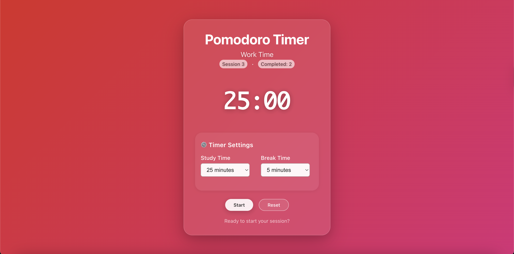

# Pomodoro Timer Web App

A simple, modern Pomodoro Timer built with React. Stay focused and boost your productivity using the Pomodoro Technique: alternate between focused work sessions and short breaks, with customizable durations for both.

## Features

- **Customizable Timer**: Set your preferred work and break durations (in 5-minute intervals)
- **Session Tracking**: See your current session and how many sessions you've completed
- **Responsive UI**: Clean, user-friendly interface
- **Start, Pause, Resume, and Reset**: Full control over your timer
- **Status Indicator**: Visual cues for work, break, and completion
- **Alarm Sound**: Plays a sound when the timer reaches zero

## Screenshots



## Getting Started

### Prerequisites
- [Node.js](https://nodejs.org/) (v14 or newer recommended)
- [npm](https://www.npmjs.com/) (comes with Node.js)

### Installation

1. **Clone the repository:**
   ```bash
   git clone https://github.com/yourusername/pomodoro-web-app.git
   cd pomodoro-web-app
   ```
2. **Install dependencies:**
   ```bash
   npm install
   ```
3. **Start the development server:**
   ```bash
   npm start
   ```
   The app will open at [http://localhost:3000](http://localhost:3000).

## Usage

- Select your desired **Work Time** and **Break Time** from the dropdown menus (in 5-minute intervals).
- Click **Start** to begin a work session.
- The timer will count down from your selected work duration.
- When the timer reaches 0, an alarm will sound and the timer will switch to your selected break duration.
- After each break, the timer will switch back to work time. This alternation continues until you reset or pause.
- Use **Pause** to stop the timer, **Resume** to continue, and **Reset** to restart the current session.

## Customization

You can adjust timer durations and session logic in `src/App.jsx` if you want to personalize your workflow further.
